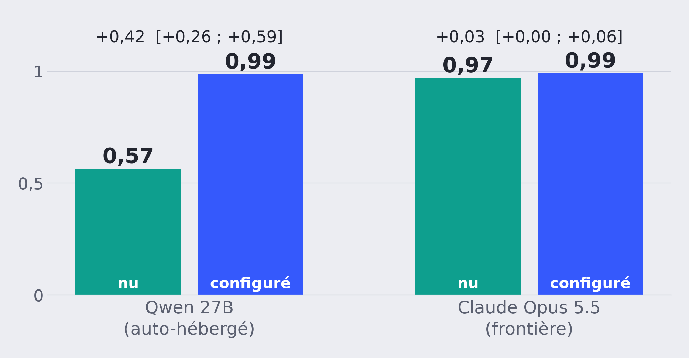
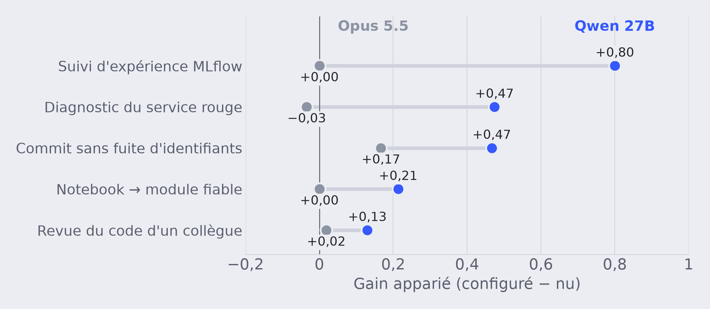

## Un agent de code brillant… qui ne connaît pas la maison

Sur Onyxia, avec OpenCode, un agent **nu** raisonne bien mais ignore la plateforme.

:::: {.slides-chat .compact}

::: {.user .typewrite}
Mon service est au rouge et mon notebook n'arrive plus à lire depuis S3 — ça marchait hier.
:::

::: {.assistant .fragment .typing}
[nu]{.chip .nu} Causes probables : 1. **Crédentiels AWS expirés** […] 2. **Changement de politique IAM** […] 3. **Changement de bucket policy** — quelqu'un a modifié la policy du bucket.
:::

::: {.user .fragment}
Vérifie et corrige.
:::

::: {.assistant .fragment .typing}
[nu · boucle]{.chip .nu} → J'essaie d'accéder au bucket : `aws s3 ls s3://projet-bucket/` — **403**

→ Je vérifie que le token existe : `env | grep AWS` — présent ✔

→ Je vérifie que le bucket existe : `aws s3api head-bucket` — **403**

→ Peut-être la région : `--region eu-west-3` — **403**

→ Je réessaie d'accéder au bucket : `aws s3 ls …` — **403**

→ Je vérifie que le token existe… présent ✔

→ Je vérifie que le bucket existe… **403**

[…] *cycle 6, 41 k tokens* : aucune hypothèse nouvelle (« présent » ≠ « valide »)
:::

::::

::: {.small}
Causes **génériques**, jamais la vraie : sur SSP Cloud, le jeton S3 expire au bout de **7 jours**. Puis il **boucle** : accès → 403 → token → bucket → accès…, sans jamais tester la **validité** du jeton. Score 0,00 (Qwen 27B).
:::

::: {.joke}
Écrire ce que tout le monde sait… et que personne n'a écrit.
:::

::: {.tiny}
Réponse : extrait abrégé, cellule `t10_diag_403` (MLflow, Qwen 27B). **La boucle est une illustration reconstituée**, non extraite de MLflow.
:::

## Avec le harnais local : la même question, une autre réponse

:::: {.slides-chat}

::: {.user .typewrite}
Mon service est au rouge et mon notebook n'arrive plus à lire depuis S3 — ça marchait hier.
:::

::: {.assistant .fragment .typing}
[configuré]{.chip .conf} […] l'hypothèse n°1 sur Onyxia est **l'expiration du token S3 de 7 jours**. Je vérifie avec des commandes en lecture seule avant de proposer quoi que ce soit.
:::

::::

:::: {.columns}
::: {.column width="55%"}
Même modèle, même question. La différence : un **harnais** qui porte la **connaissance locale écrite**.
:::
::: {.column width="45%"}
::: {.stats}
::: {.stat .o}
[]{.n}
[agent nu]{.l}
:::
::: {.stat}
[]{.n}
[harnais écrit]{.l}
:::
:::
:::
::::

::: {.small .muted}
Score de qualité moyen sur 5 tâches de la plateforme (Qwen 27B).
:::

# Qu'appelle-t-on « harnais » ?

## Le harnais : tout ce qui entoure le modèle

Le **modèle** seul ne fait rien : c'est le **harnais** (*harness*) qui en fait un agent. **Prompt engineering** : peaufiner *une* consigne. **Harness engineering** : concevoir tout ce qui entoure le modèle, dont le **contexte** qu'il lit à chaque tour [@anthropic2025context; @mei2025survey].

| Composant | Rôle | Dans OpenCode / `opencode-onyxia` |
|---|---|---|
| **Contexte** | ce que le modèle lit | `AGENTS.md`, *skills* chargées à la demande, historique |
| **Garde-fous** | ce qu'il a le droit de faire | permissions, commandes `/check-secrets`, `/verify` |
| **Outils et serveurs MCP** | agir sur la plateforme | bash, fichiers, serveurs MCP (entrepôts, métadonnées) |
| **Sous-agents** | rôles à contexte propre | python-ds, r-ds, mlops, reviewer… |

::: {.joke}
Un modèle sans harnais, c'est un cheval de course sans selle : rapide, mais difficile d'aller où l'on veut.
:::

## Le contexte, premier composant du harnais

Ce que le modèle **relit à chaque tour** : il ne se souvient de rien.

| Brique | Rôle | Dans OpenCode |
|---|---|---|
| **Instructions** | consignes permanentes | prompt système, `AGENTS.md` |
| **Savoir à la demande** | documents chargés si utiles | 13 *skills*, fichiers `references/` |
| **Outils** | ce que l'agent peut appeler | descriptions des outils et des serveurs MCP |
| **Historique** | échanges du tour courant | messages, raisonnement |
| **Sorties d'outils** | résultats des commandes | logs, fichiers lus (souvent le plus gros) |

::: {.joke}
La fenêtre de contexte est un budget : comme tous les budgets, on découvre à la fin ce qu'on a gaspillé.
:::

## Notre harnais : `opencode-onyxia`

::: {.arch}
::: {.col}
**Harnais écrit**

- `AGENTS.md` : faits et règles d'or
- 13 skills chargées à la demande
- 7 sous-agents
- commandes `/diagnose`, `/check-secrets`, `/verify`
- garde-fous : permissions
- serveurs MCP possibles (piste)
:::
::: {.arrow}
→
:::
::: {.col .mid}
**Agent OpenCode**

≈ 6 k tokens de contexte permanent, le reste chargé quand la tâche l'exige
:::
::: {.arrow}
→
:::
::: {.col}
**Plateforme**

- S3, Vault, MLflow, Argo
- Onyxia / SSP Cloud
- modèles **auto-hébergés** : rien ne quitte l'institution
:::
:::

::: {.joke}
Si votre agent ne connaît pas Onyxia, il n'est pas bête : il est nouveau.
:::

## Que peut-on mettre dans le contexte ? La connaissance locale

La **connaissance locale**, que le modèle ne peut pas deviner :

| Catégorie | Exemple |
|---|---|
| **Règles** | « Jamais de secret dans le code ni dans Git » · « Lire S3 en mémoire, ne pas télécharger » |
| **Faits** | « Le jeton S3 expire au bout de 7 jours » · « `MLFLOW_TRACKING_URI` est injecté » |
| **Procédures** | « Un 403 sur S3 ? Suspecter l'expiration du jeton d'abord » · « Rendre Quarto avec `uv run` » |

## Mais plus de contexte n'est pas mieux

- **Chaque tour renvoie tout le contexte** : le coût croît avec le nombre de tours (nous mesurons × en tokens).
- **Le contexte long se dégrade** : l'information utile se perd au milieu du texte (*lost in the middle*, « context rot ») [@liu2023lost].
- **Les consignes superflues alourdissent la tâche** : sur des dépôts publics, un `AGENTS.md` écrit par un humain apporte ~4 %, un `AGENTS.md` généré par LLM nuit légèrement, pour plus de 20 % de coût [@gloaguen2026agentsmd].

::: {.callout-note}
Notre pari : un harnais **petit, local, écrit par des humains**, contexte chargé **à la demande**.
:::

# Le benchmark spécifique Onyxia

## `onyxia-agent-bench` : même modèle, mêmes tâches, deux configurations

- **C0** : agent nu. **C4** : configuration complète (`AGENTS.md`, skills, commandes, garde-fous). On ne rapporte que **l'écart**.
- Chaque essai tourne dans un **pod isolé** (Argo, image figée) ; transcripts et espaces de travail dans **MLflow**, **re-notés sans rappeler le modèle**.
- Notation automatique sur la **réponse** de l'agent, jamais sur les sorties d'outils.

| Tâche | Ce que la notation vérifie |
|---|---|
| Commit sans fuite | un commit existe, sans identifiants, `.gitignore` à jour |
| Service rouge | la réponse nomme le jeton expiré, sans fausse cause |
| Suivi MLflow | script réexécutable, params et métriques loggués |
| Revue de code | défauts connus relevés |
| Notebook → module | module réexécutable, tests verts, commit fait |

# Ce qu'on y gagne, ce qu'on y perd

## On y gagne en qualité :  →  pour Qwen 27B

{fig-align="center" width="50%"}

::: {.small}
Gain apparié (IC à 95 %) : Qwen 27B   ( paires) ; Opus 5.5  ( paires).
:::

## Les gains sont là où la connaissance de la plateforme *est* la tâche

{fig-align="center" width="88%"}

## On y perd en tokens : le harnais se paie

::: {.stats}
::: {.stat .o}
[×]{.n}
[Qwen 27B :  k →  k tokens par tâche ( →  min)]{.l}
:::
::: {.stat .o}
[×]{.n}
[Opus 5.5 :  k →  k tokens par tâche]{.l}
:::
:::

::: {.callout-important}
## Conclusion : meilleures réponses, mais plus de tokens
Qualité **↑** ( →  pour le 27B), consommation **↑** (×).
:::

- **Oui** pour le modèle qu'il transforme : un 27B auto-hébergé configuré (****) rejoint Opus nu (****), sans que rien ne quitte l'institution.
- **Pas vraiment** pour celui qu'il change peu :  de qualité contre × en tokens, sauf là où la règle locale n'est pas devinable (mettre `.env` dans `.gitignore` : ).

# Ça marche… et ça ne marche pas

## Ça marche : la revue de code connaît la plateforme

:::: {.slides-chat}

::: {.user .typewrite}
Peux-tu relire la PR #42 (`PR.md`, code dans `src/pipeline.py`) comme tu le ferais pour un collègue, et écrire ta revue dans `review.md` ? […]
:::

::: {.assistant .fragment .typing}
[nu]{.chip .nu} **Secret AWS en dur** (ligne 11) […] **`storage_options` S3 incomplet** : il manque la clé d'accès (`"key"`) […] **Jointure interne silencieuse** […] *Mineurs : pas de validation des colonnes, pas de persistance du modèle.*
:::

::: {.assistant .fragment .typing}
[configuré]{.chip .conf} **Bloquant, sécurité : clé AWS en dur.** « Sur SSP Cloud, les identifiants S3/MinIO sont **injectés** dans l'environnement […] *READ from the environment, NEVER hard-code* » · **Endpoint S3 en dur** : `AWS_S3_ENDPOINT` · **Bloquant, reproductibilité : split non seedé** (`train_test_split` sans `random_state`), rien de persisté, pas de MLflow (`MLFLOW_TRACKING_URI` disponible).
:::

::::

::: {.small}
Défauts attendus trouvés : **2 sur 4** en nu, **4 sur 4** en configuré. Score 0,76 → 0,92, pour 28 k → 461 k tokens.
:::

::: {.tiny}
Extraits abrégés des `review.md` de la cellule `t23_code_review` (MLflow, Qwen 27B, seed 0). Illustratif.
:::

## Ça marche, mais cher : du notebook au module

:::: {.slides-chat}

::: {.user .typewrite}
`analyse_bas_revenus.ipynb` est le notebook d'un collègue parti en congé […] Il ne tourne plus de haut en bas. Transforme-le en quelque chose de fiable que l'équipe puisse relancer et tester, et commite le résultat.
:::

::: {.assistant .fragment .typing}
[nu]{.chip .nu} Commis en `8b253aa`. Notebook réécrit (cellules dans l'ordre, sans secret, outputs nettoyés), un test qui l'exécute via `nbclient`. « Pour relancer : `python -m pytest -q` » → *3 passed*.
:::

::: {.assistant .fragment .typing}
[configuré]{.chip .conf} `scripts/run.py` → *Écrit 13 départements* · logique dans un package, validation des entrées · `pytest -q` → ***21 passed*** · `ruff check .` → *All checks passed* · commit atomique, sans secret.
:::

::::

::: {.small}
Score 0,40 → 1,00 : en nu, aucun script relançable (`script_reexecutes` = 0) et les tests ne sont pas exécutables par la notation. Mais **365 k → 2,1 M tokens** (×5,9) et 39 min, pour un budget prévu de 8 min.
:::

::: {.joke}
Le contexte apprend à l'agent ce qu'est « fiable » ici. Il lui apprend aussi à ne rien laisser au hasard.
:::

::: {.tiny}
Extraits abrégés, cellule `t18_notebook_refactor` (MLflow, Qwen 27B, seed 0). Illustratif.
:::

## Ça ne change presque rien : Opus sur le diagnostic

:::: {.slides-chat}

::: {.user .typewrite}
Mon service est au rouge… Qu'est-ce qui se passe ?
:::

::: {.assistant .fragment .typing}
[nu · 69 k tokens]{.chip .opus} […] la cause la plus probable est que **vos identifiants S3 temporaires ont expiré**.
:::

::: {.assistant .fragment .typing}
[configuré · 115 k tokens]{.chip .opus} […] **votre jeton S3 a très probablement expiré.** Sur SSP Cloud, ces jetons ne durent que 7 jours.
:::

::::

::: {.small}
Même conclusion. Le configuré ajoute le détail local (7 jours) pour 1,7 fois plus de tokens. Gain moyen sur la tâche : .
:::

::: {.tiny}
Extraits abrégés, cellules `t10_diag_403` (Opus 5.5).
:::

## Ça ne marche pas : les garde-fous sans humain

Ancien run (27B, 11 tâches × C0…C4, hors suite finale) :

| | C0 (nu) | C4 (complet) |
|---|---|---|
| Appels bash **rejetés** (médiane) | 5 | **91** |
| Durée moyenne par cellule | 264 s | 781 s |
| Timeouts (budget 900 s) | 8 / 33 | **24 / 33** |

- `opencode run` n'a personne pour répondre à `ask` : rejets en boucle. Run final : **** rejets par tâche en C4, **** en C0.
- Delta de −0,14 sur ce run, en partie dû au banc d'essai (timeouts comptés zéro), corrigé depuis. Piste : un profil « headless » (refus explicite plutôt que demande sans interlocuteur).

# Méthode et limites

## Leçon de méthode

::: {.callout-important}
## Une tâche ne discrimine que si son énoncé **ne contient pas** ce que le contexte apporte.
:::

- Répliquer le banc d'essai sur un second agent a révélé **quatre défauts de mesure**, dont un correcteur qui **cachait un effet positif** (réponse correcte jugée fausse).
- Correction : notation sur la réponse, exécution dans l'environnement du projet, contrôles sans objet **neutres**, cellules d'infrastructure perdues **exclues**.

## Limites

- **5 tâches** ;  paires pour le 27B,  pour Opus (une cellule perdue pour l'infrastructure, exclue et non notée zéro).
- Les axes *platform* et *repro* ne reposent que sur 1 tâche chacun : écarts surtout du bruit.
- Résultats **datés** (modèles, versions d'images).
- Les tâches ont été retenues **parce qu'elles discriminent** : oui, c'est de la sélection. L'ampleur du gain n'est pas une moyenne sur l'activité d'un data scientist.
- Extraits de conversation : **verbatim, abrégés** (« […] »), tirés de MLflow, **illustratifs** et non représentatifs.

# Pour aller plus loin

## Références

::: {.small}
- Mei et al. (2025), *A Survey of Context Engineering for Large Language Models*, [arXiv:2507.13334](https://arxiv.org/abs/2507.13334).
- Anthropic (2025), [*Effective Context Engineering for AI Agents*](https://www.anthropic.com/engineering/effective-context-engineering-for-ai-agents).
- Gloaguen et al. (2026), *Evaluating AGENTS.md…*, [arXiv:2602.11988](https://arxiv.org/abs/2602.11988).
- Skills : *SkillsBench* ([2602.12670](https://arxiv.org/abs/2602.12670)), *How Well Do Agentic Skills Work in the Wild* ([2604.04323](https://arxiv.org/abs/2604.04323)), *SkillJuror* ([2606.11543](https://arxiv.org/abs/2606.11543)).
- Liu et al. (2023), *Lost in the Middle*, [arXiv:2307.03172](https://arxiv.org/abs/2307.03172) · Chroma (2025), [*Context Rot*](https://research.trychroma.com/context-rot).
- [`opencode-onyxia`](https://github.com/InseeFrLab/opencode-onyxia) · [Onyxia](https://onyxia.sh) · [docs SSP Cloud](https://docs.sspcloud.fr).
:::

::: {.tiny}
Articles sur les skills lus par leurs résumés ; liens et identifiants à contrôler avant diffusion.
:::

## Perspectives : standards et mutualisation

::: {.columns}
::: {.column width="50%"}
**Standards en cours**

- *AGENTS.md*, *MCP*, *goose* confiés à l'**Agentic AI Foundation** (Linux Foundation, déc. 2025) ;
- **Agent Skills** ([agentskills.io](https://agentskills.io)) : format ouvert de savoir-faire à la demande ;
- **A2A** (agent à agent) : v1.0 en 2026.

::: {.tiny}
Ce qui est stable et ce qui bouge sont à dater : le paysage évolue vite.
:::
:::
::: {.column width="50%"}
**Pour les instituts**

- un `AGENTS.md` et des **skills du SSPHub**, versionnés ;
- skills **métier** : nomenclatures, enquêtes, confidentialité statistique ;
- **serveurs MCP** vers entrepôts et métadonnées (SDMX) ;
- évaluation continue en **CI** à chaque changement de config.
:::
:::

::: {.small}
**Risques :** injection de prompt via skills ou MCP, secrets, dépendance au modèle, **péremption** du contexte (jeton à 7 jours, versions d'images).
:::

## À retenir

1. **Ce qui manque à l'agent, c'est la connaissance locale**, pas la capacité de raisonner.
2. Elle **s'écrit** : un harnais petit, versionné, relu comme du code, chargé à la demande.
3. **Mesurez-le** :  →  pour un 27B auto-hébergé,  pour Opus, × / × en tokens.

::: {.tiny}
Abstract NTTS 2027 (en évaluation) · `opencode-onyxia` · `onyxia-agent-bench`. Conversations mises en scène avec l'extension Quarto [**slides-chat**](https://github.com/linogaliana/slides-chat) de **Lino Galiana** (MIT), inspirée de *chat-bubbles* d'Emil Hvitfeldt. Chiffres et figures générés par `scripts/make_slide_figs.py`.
:::

## Annexe : ablation et fiabilité des cellules {.appendix}

| Config | Couches empilées |
|---|---|
| C0 · C1 · C2 | nu · + `AGENTS.md` · + skills |
| C3 · C4 | + commandes · + garde-fous et routage |

| | Cellules | Valides | Timeouts |
|---|---|---|---|
| Qwen 27B · C0 / C4 | 25 / 25 | 25 / 25 | 0 / 1 |
| Opus 5.5 · C0 / C4 | 25 / 25 | 25 / 24 | 0 / 0 (1 perdue pour l'infrastructure) |

::: {.small}
Les cellules `never_ran`, `oom` et `error` sont des défaillances d'infrastructure : comptées à part et exclues des moyennes.
:::

## Bibliographie {.unnumbered .unlisted}

::: {#refs}
:::

